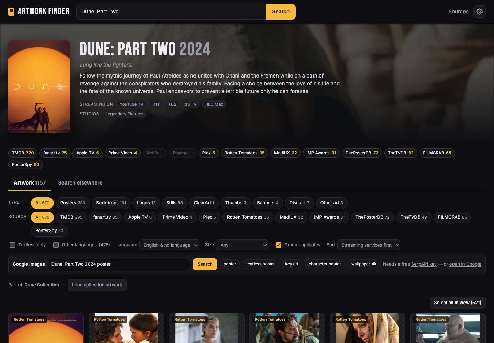
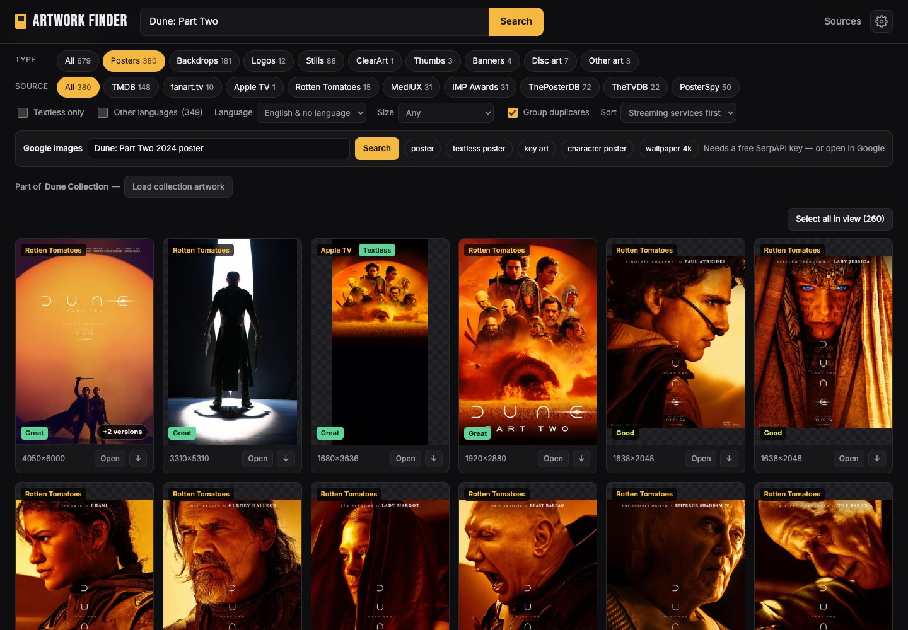
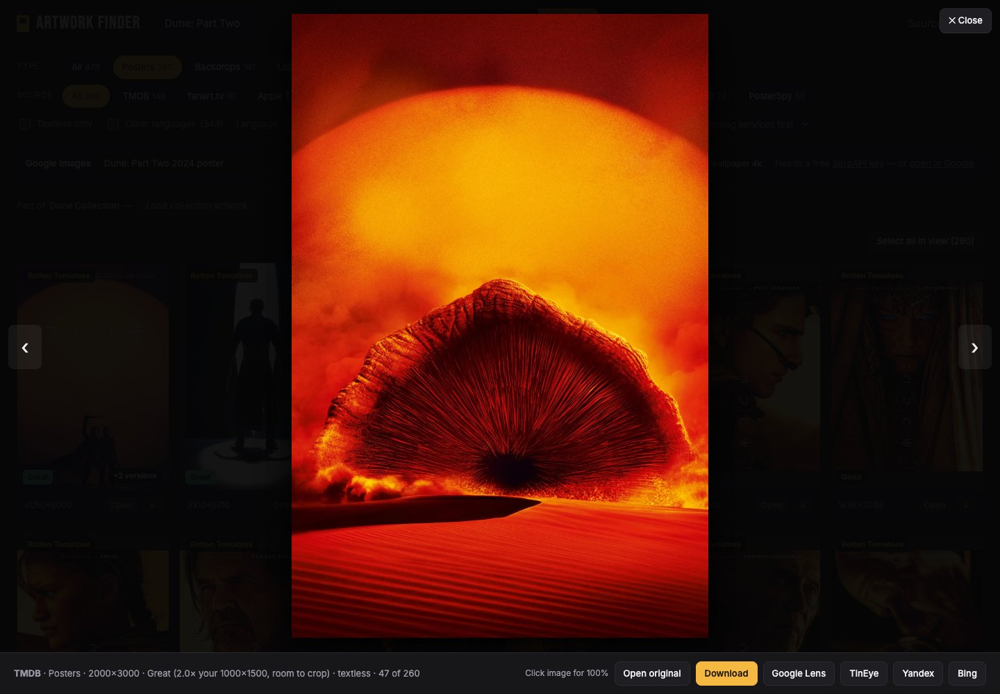
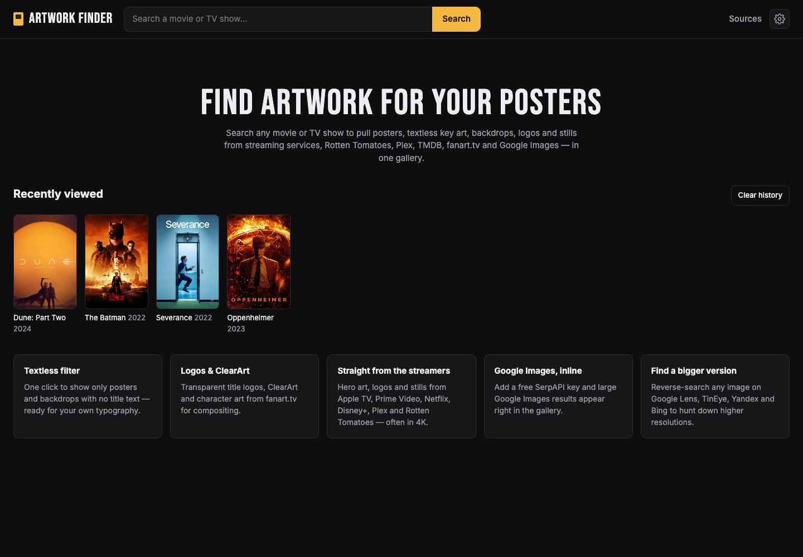
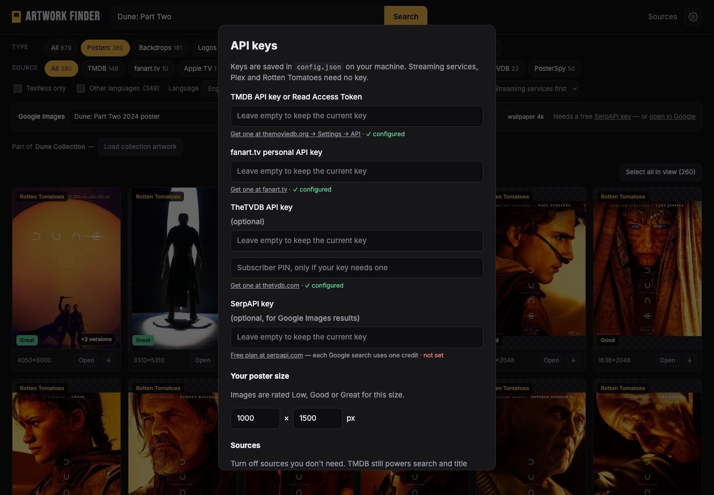

# Artwork Finder

Find posters, textless key art, backdrops, logos and press assets for movies and TV shows.



<table>
  <tr>
    <td width="50%"></td>
    <td width="50%"></td>
  </tr>
  <tr>
    <td><b>Gallery:</b> filter by type and source, see quality for your poster size, duplicates grouped.</td>
    <td><b>Viewer:</b> full size, click to zoom, download or reverse-search for a bigger copy.</td>
  </tr>
  <tr>
    <td width="50%"></td>
    <td width="50%"></td>
  </tr>
  <tr>
    <td><b>Home:</b> recently viewed titles and searches.</td>
    <td><b>Settings:</b> API keys, your poster size, and which sources to use.</td>
  </tr>
</table>

## Install with Docker

You need Docker: [Docker Desktop](https://www.docker.com/products/docker-desktop/) on Mac or Windows, or Docker with the Compose plugin on Linux or a NAS.

### Option 1: ready-made image (easiest)

Make an empty folder, open a terminal in it and run:

```bash
curl -o docker-compose.yml https://raw.githubusercontent.com/majorgiant/artworkfinder/main/docker-compose.yml
docker compose up -d
```

Then open **http://localhost:4321**, click the gear icon and add your API keys (see below). The app keeps running in the background and starts again after a restart.

**Update** to the latest version: `docker compose pull && docker compose up -d`

### Option 2: build from the code

```bash
git clone https://github.com/majorgiant/artworkfinder.git
cd artworkfinder
docker compose up -d --build
```

**Update:** `git pull && docker compose up -d --build`

In a copy of the code, `docker-compose.override.yml` is picked up automatically and builds the image from that code. Without it, `docker-compose.yml` downloads the ready-made image.

### API keys

All free. Only TMDB is really needed; the others add more artwork.

| Key | Get it at | What it adds |
|---|---|---|
| **TMDB** | [themoviedb.org → Settings → API](https://www.themoviedb.org/settings/api) | Movie search, TMDB posters, backdrops, logos, season and collection art |
| fanart.tv | [fanart.tv/get-an-api-key](https://fanart.tv/get-an-api-key/) | ClearLOGOs, ClearArt, character art, disc art, banners |
| TheTVDB | [thetvdb.com/api-information](https://thetvdb.com/api-information) | More posters, backgrounds, season posters and logos |
| SerpAPI | [serpapi.com](https://serpapi.com) | Google Images results inside the app (each search uses one credit) |

Add them in the app's Settings (gear icon), or copy `.env.example` to `.env`, fill it in and run `docker compose up -d` again. Keys saved in Settings win over `.env`.

Without any keys the app still searches TV shows (through TVmaze) and loads artwork from the streaming services and poster sites.

### Everyday use

- **Stop:** `docker compose down`. **Start again:** `docker compose up -d`.
- **Logs:** `docker compose logs -f`.
- **Other port:** set `PORT=8080` in `.env` (or edit `docker-compose.yml`), then `docker compose up -d`.
- **Linux or NAS user IDs:** the app runs as user and group `1000` and makes the `data` folder its own at startup. On a NAS that expects other IDs, set `PUID` and `PGID` in `.env` (find yours with `id`; Unraid uses `99` and `100`).

### Your data

Everything personal lives in the `data` folder next to `docker-compose.yml`:

- `config.json`: your API keys, poster size and source settings
- `history.json`: recent searches and titles
- `sizes.json` and `thumbs/`: caches that make repeat visits fast (safe to delete)

Back up the `data` folder to keep your settings. Delete it to start fresh. **Don't share it**: it contains your keys.

### Good to know

- **There's no login.** Anyone who can reach the app can use it, and your keys with it. That's fine on your own computer or home network, but don't open the port to the internet.
- **Region:** streaming results (Prime Video, Netflix) follow the country your internet connection is in, plus the US, UK, Australia, New Zealand and Canada.
- **ThePosterDB** allows 30 requests a minute per internet connection, so the app paces itself. The first time you open a title with many ThePosterDB posters, they take a minute or two to fill in.

## Run without Docker

```bash
npm start   # or: node server.js
```

No dependencies; needs Node 18+. Settings are saved to `config.json` in the project folder.

## Share it with others

Send people the link to this repository: https://github.com/majorgiant/artworkfinder. Option 1 above is all they need.

Every push to `main` rebuilds the ready-made image automatically (GitHub Actions, see `.github/workflows/docker-image.yml`), so others get your changes with `docker compose pull`. Your keys and personal data are never uploaded: `config.json`, `data/`, `.env` and `dist/` are in `.gitignore`.

To send someone a zip instead, run `./share.sh`. It makes `dist/artworkfinder-<date>.zip` with only the app's files and checks that none of your keys ended up in it.

## What it pulls together

All of these land in one gallery. You can filter by type, source, textless only, language and size.

- **Real sizes and quality:** when a source doesn't report an image's size, the server reads it from the first bytes of the file. Sizes are cached in `data/sizes.json`. Each image is rated **Low / Good / Great** for your poster size (Settings, default 1000×1500): the largest crop in your poster's shape that fits in it is under 1×, 1–1.5× or over 1.5× your size. Logos are rated on whether they're wide enough to span about 80% of the poster. The Size filter can show only Good or Great images.
- **Grouped duplicates:** look-alike images from different sources become one card showing the largest version, with a "+N versions" button. Matching uses a perceptual hash of each thumbnail, cached in the browser.
- **History:** recent searches and opened titles appear on the home page and in a dropdown under the search box, saved in `data/history.json`. Remove single entries with × or use Clear history.
- **ZIP download:** tick images (or "Select all in view") and download them as one ZIP with descriptive file names.
- ThePosterDB allows 30 requests a minute per connection, so the app spaces its requests to ThePosterDB (24 a minute). The first visit to a title with many ThePosterDB posters takes a minute or two to measure them all.

- **Streaming services and review sites** (`providers.js`, no key needed): Apple TV (textless hero art up to 4320×3240, title logos, episode stills), Prime Video (4K cover art, pack shots), Netflix (1920×1080 billboard; titles Netflix no longer carries are skipped), Disney+ (4K backgrounds, logos), Plex (4K backgrounds, logos) and Rotten Tomatoes (posters and photo galleries at original size). Wikidata supplies each title's ID on these services. For titles that only stream in other countries (or are too new for Wikidata), the app finds the service links on JustWatch for a country where TMDB lists the title, since the services' own search only sees this server's country. Prime Video and Rotten Tomatoes also fall back to searching their sites.
- **Poster sites** (also in `providers.js`): MediUX (full-size community sets, including episode title cards), IMP Awards (every official theatrical poster variant at up to 2024×3000) and ThePosterDB (full-size files as uploaded, typically 1000×1500 to 2000×3000). MoviePosterDB, CineMaterial, MovieStillsDB, ShotDeck and ArtStation block automated requests or disallow them, so they're links only.
- **Image APIs**: TMDB, fanart.tv, TVmaze and TheTVDB (add your free TheTVDB API key, and PIN if your key needs one, in Settings).
- **FILMGRAB**: high-quality frame grabs from the film, in its own aspect ratio, so they usually rate Low for a 2:3 poster crop.
- **PosterSpy**: alternative posters by independent artists, marked "Fan art". Useful for inspiration; the artwork belongs to those artists.
- **Google Images**: results show up in the gallery once you add a SerpAPI key. Without a key, the search box opens Google in a new tab.
- **Search elsewhere** (`public/sources.js`): links to ThePosterDB, MediUX, IMP Awards, MoviePosterDB, CineMaterial, Blu-ray.com, Bing, Yandex and more, each pre-filled with the title. The Sources page also lists studio and streaming press sites.
- **Reverse image search** (Google Lens, TinEye, Yandex, Bing) for finding bigger or textless versions.

To add a source, add an entry to `public/sources.js`.

## License

MIT, see `LICENSE`.
